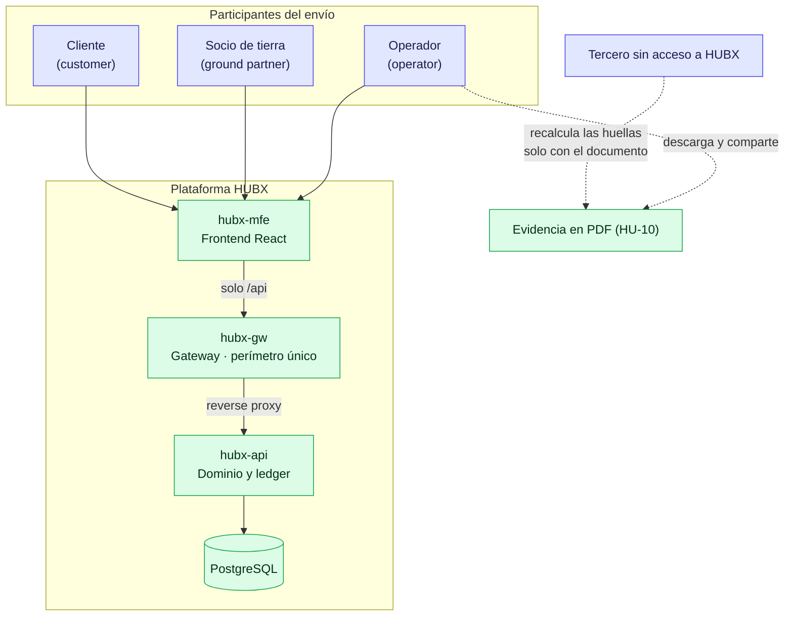
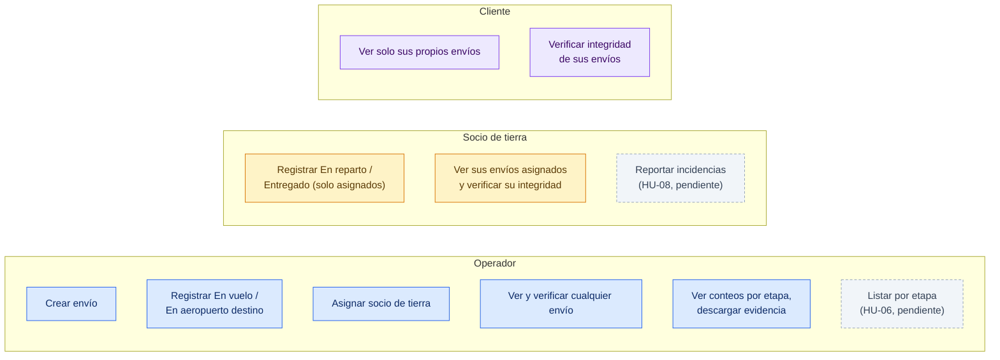

# 01 · Contexto del sistema

HUBX es una plataforma de trazabilidad de carga aérea donde los participantes de un envío comparten
un historial único, confiable y verificable. Hay tres roles de negocio y un perímetro único de
entrada (el gateway).

## Actores y límites

El tercero nunca entra a HUBX: verifica el documento por su cuenta. La evidencia prueba que el
historial es consistente consigo mismo; no prueba por sí sola que HUBX no lo reconstruyó entero, y
las huellas cubren los identificadores de las partes, no sus nombres.

## Qué puede hacer cada rol

Resumen de la matriz de permisos del backlog (regla transversal 6). Pendientes de implementar: listar
por etapa (HU-06) y reportar incidencias (HU-08).

## Reglas transversales clave

- **Sesión:** dura una hora; luego se pide iniciar sesión otra vez antes de cualquier operación.
- **Secuencia:** las etapas avanzan siempre en orden, sin retroceso ni repetición.
- **Inmutabilidad:** un avance no se modifica ni se borra.
- **Privacidad:** quien no puede ver un envío recibe la misma respuesta que si no existiera.
- **Listas:** se muestran de a 20, lo más reciente primero (salvo que una historia diga otra cosa; en
  HU-07 va primero el envío asignado hace más tiempo).
