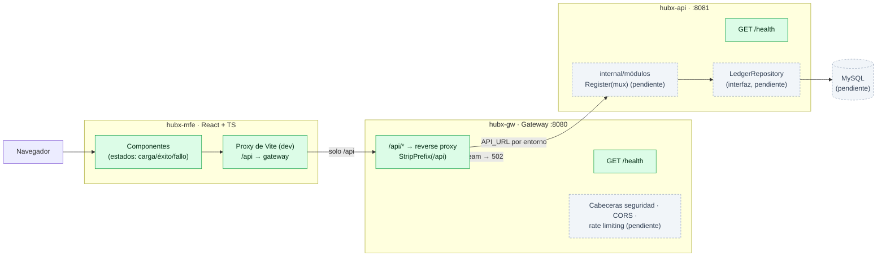
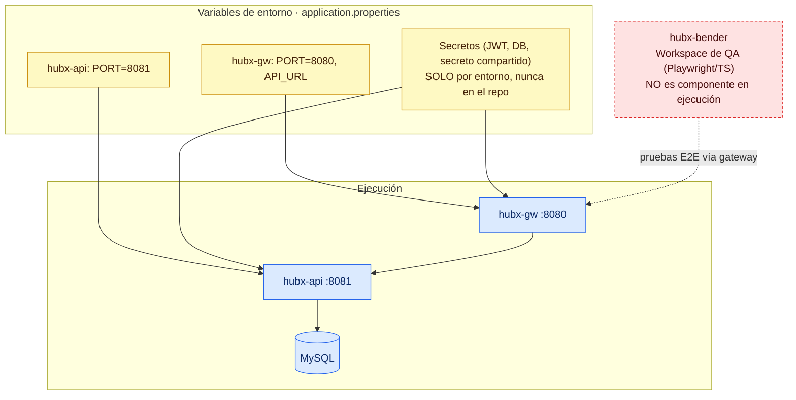
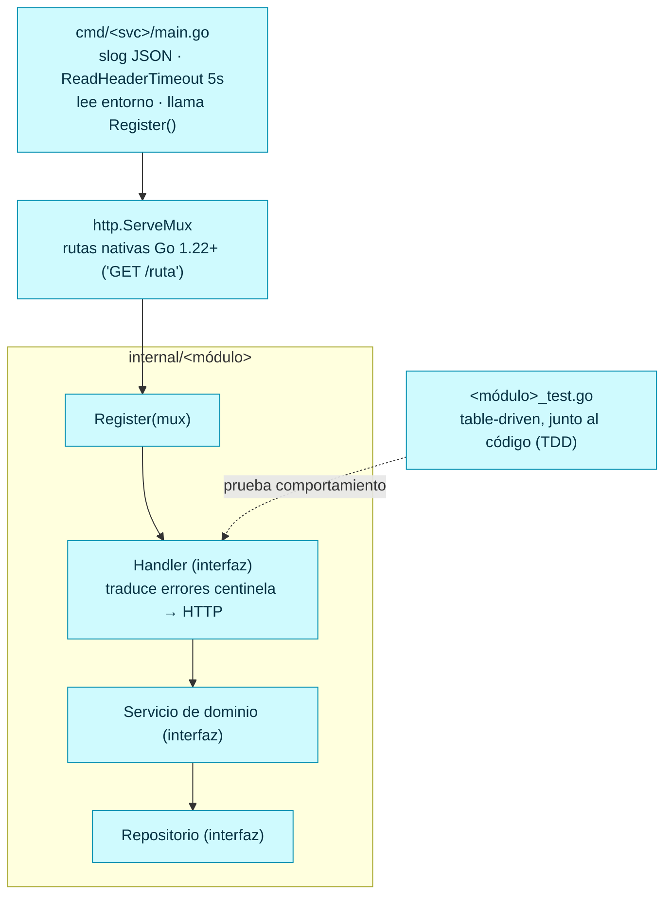

# 02 · Arquitectura

Arquitectura de tres capas con gateway obligatorio (principio II). El frontend nunca habla directo
con la API: todo el tráfico pasa por el gateway. Stack fijado por el principio III: Go estándar
(`net/http` + `ServeMux`), MySQL, React + TypeScript estricto.

## Componentes y flujo de tráfico

**Estado actual del código:** solo `/health` en gateway y API, y el reverse proxy funcionan
hoy. Los módulos de dominio, el `LedgerRepository`, la persistencia MySQL y los controles de
seguridad del gateway están definidos por la constitución pero aún no implementados.

## Despliegue y configuración por entorno

## Estructura interna de un servicio Go (principio IV)

Cada módulo vive bajo `internal/<módulo>`, expone `Register(mux)` y se inyecta por constructores
que devuelven interfaces. El `main` se mantiene mínimo.

> El módulo `health` ya sigue este patrón: `NewHandler()` devuelve `http.Handler`, `Register(mux)`
> monta `GET /health`, y acepta solo GET (405 en otros métodos).
