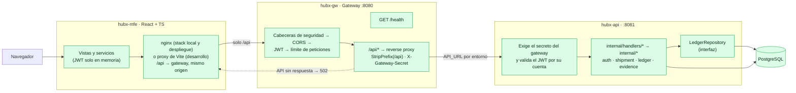
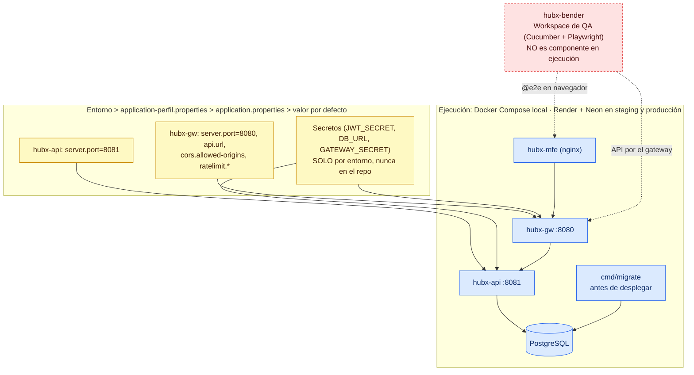
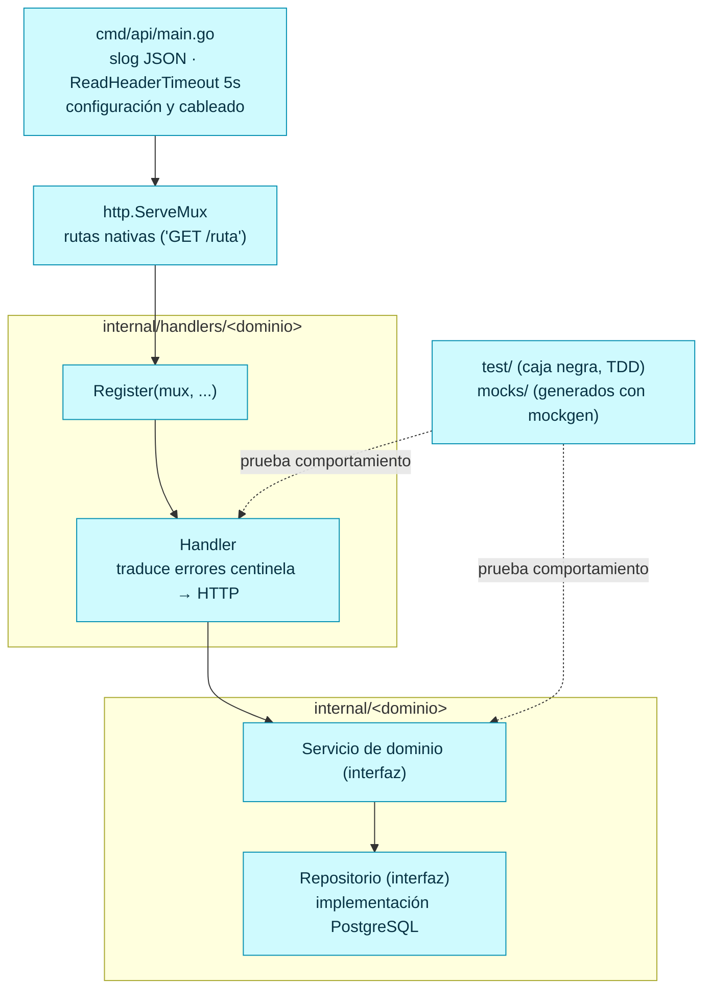

# 02 · Arquitectura

Arquitectura de tres capas con gateway obligatorio (principio II). El frontend nunca habla directo
con la API: todo el tráfico pasa por el gateway. Stack fijado por el principio III: Go estándar
(`net/http` + `ServeMux`), PostgreSQL, React + TypeScript estricto.

## Componentes y flujo de tráfico

**Estado actual del código:** el dominio, el ledger, la persistencia y la validación del JWT en ambos
servicios están publicados. Las cabeceras de seguridad, el CORS restrictivo (lista vacía por defecto) y
el límite de peticiones (120 por minuto por usuario, 10 por minuto por correo en el inicio de sesión)
son de la *(historia 011)*; viven en memoria por instancia del gateway.

## Rutas de la API

Vistas desde el navegador; el gateway quita `/api`. Contratos en `contracts/`.

| Ruta | Historia |
|---|---|
| `GET /health` (gateway), `GET /api/health` | Salud, sin sesión |
| `POST /api/auth/sign-in` | HU-01, sin sesión |
| `POST /api/shipments` | HU-02 |
| `POST /api/shipments/{code}/updates`, `GET /api/ground-partners` | HU-03 |
| `GET /api/shipments/{code}/traceability` | HU-04 |
| `GET /api/shipments/{code}/integrity` | HU-05 |
| `GET /api/assigned-shipments` | HU-07 |
| `GET /api/shipments/stage-counts` | HU-09 |
| `GET /api/shipments/{code}/evidence` | HU-10 |

HU-06 y HU-08 no están implementadas.

## Despliegue y configuración por entorno

`cmd/api` todavía lee el puerto directamente de `PORT` (pendiente en `memory.md`).

## Estructura interna de un servicio Go (principio IV)

El dominio vive en `internal/<dominio>` y no importa `net/http`; los handlers viven en
`internal/handlers/<dominio>`, exponen `Register(mux, ...)` y traducen los errores centinela a HTTP. Las
dependencias se inyectan por constructores.

> El gateway no tiene dominio: `internal/proxy` y `internal/middleware` y, con la *(historia 011)*,
> `internal/config`, `internal/ratelimit` e `internal/server` (la cadena de middlewares).
