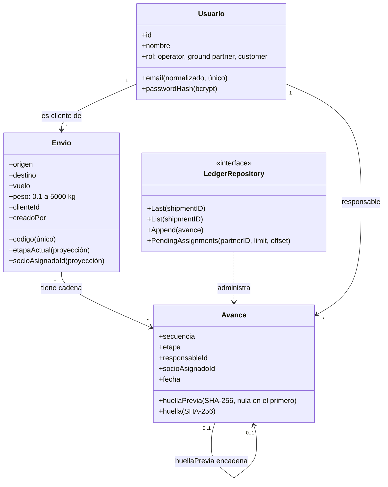
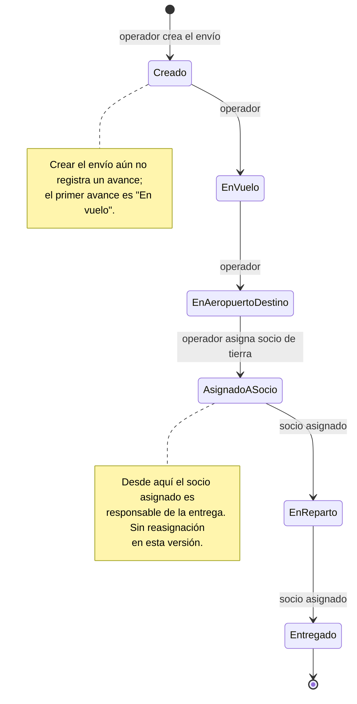
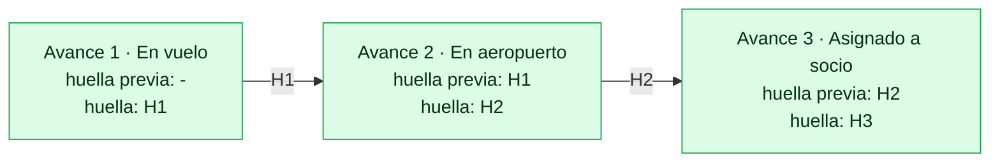
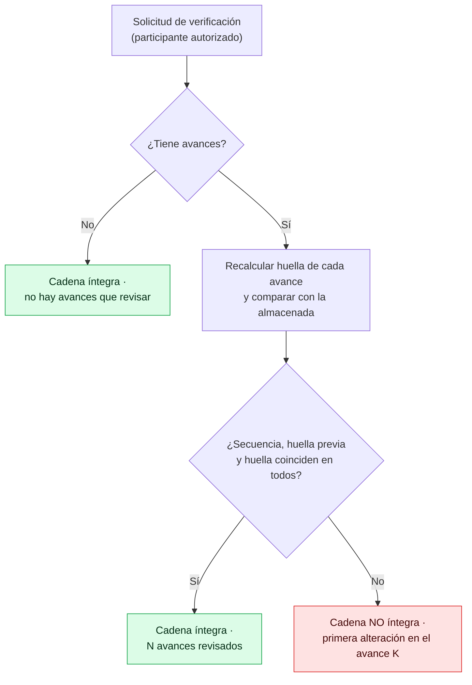
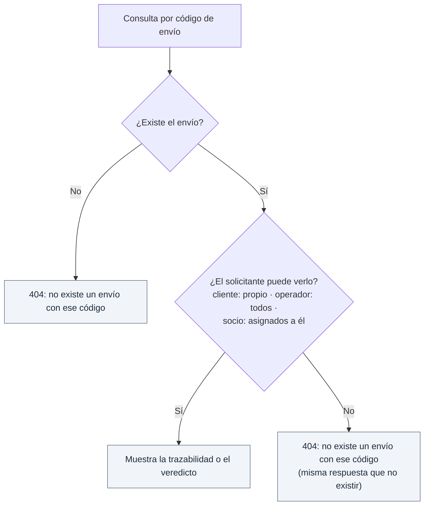

# 03 · Dominio y ledger encadenado

El estado canónico de cada envío es un **ledger de avances** encadenados por huella SHA-256, cada uno con
su responsable identificado (principio I). Los avances **no están firmados criptográficamente**: la
identidad del responsable sale de la sesión autenticada, y las firmas por participante son una extensión
futura. El ledger es inmutable: nada se actualiza ni se borra (en esta versión tampoco hay correcciones).
Todo acceso al ledger pasa por la interfaz `LedgerRepository`.

## Modelo de dominio

Tablas `users`, `shipments` y `updates` (migración `0001`). `stage` y `assigned_partner_id` del envío son
una proyección del ledger para lecturas rápidas. Las incidencias (HU-08) no existen todavía.

`Append` inserta el avance y actualiza la proyección del envío en una sola transacción. Un trigger de
PostgreSQL rechaza `UPDATE` y `DELETE` sobre `updates`.

## Etapas del envío (máquina de estados)

Las etapas avanzan siempre en orden, sin retroceso ni repetición (regla transversal 2). "Asignado a
socio" solo se alcanza asignando un socio de tierra desde "En aeropuerto destino".

## Encadenamiento e integridad (HU-05)

Cada avance guarda la huella del anterior. La huella es el SHA-256 de siete líneas `clave=valor`
(`contracts/hu03-record-update.md`): envío, secuencia, etapa, responsable, socio asignado, fecha y huella
previa. Cubre identificadores, no nombres. Verificar recalcula las huellas y señala el primer avance
alterado.

## Privacidad en consultas (HU-04 / HU-05)

Quien no puede ver un envío recibe la misma respuesta que si no existiera, para no filtrar su
existencia. Una sola regla (`shipment.CanSee`) sirve a HU-03, HU-04, HU-05 y HU-10.

