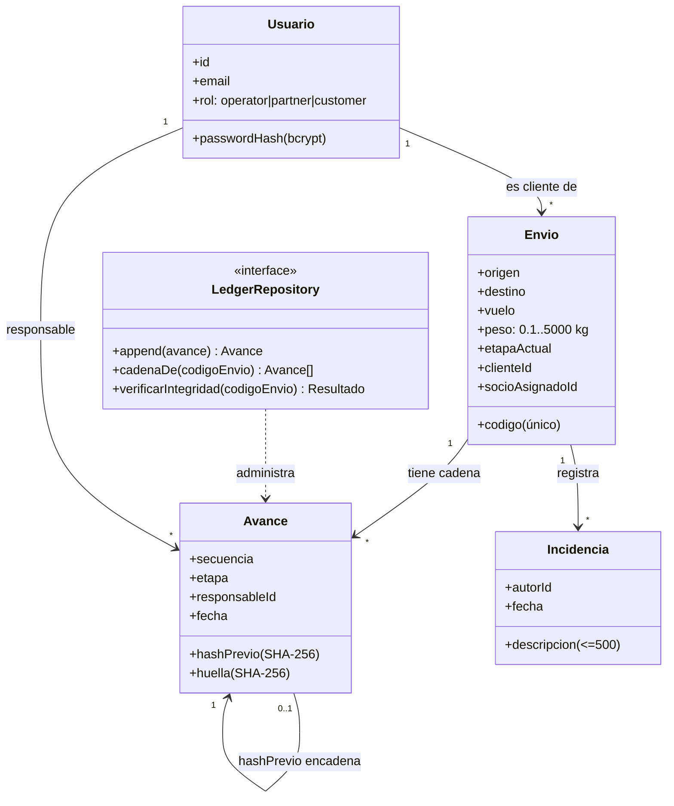
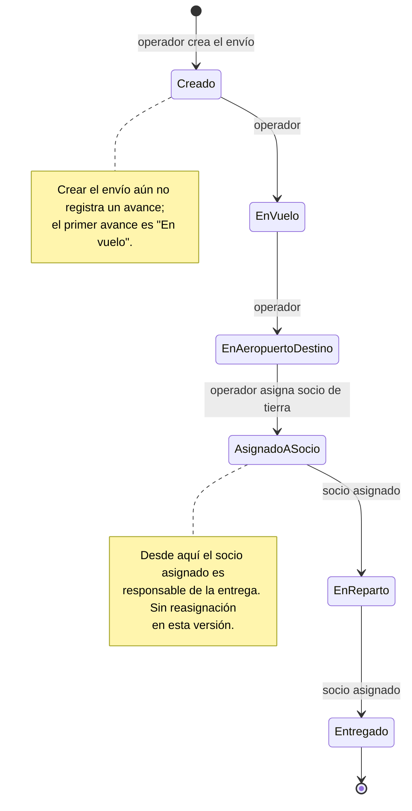
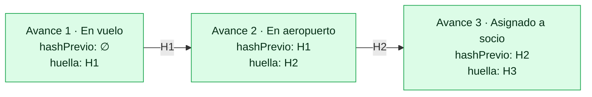
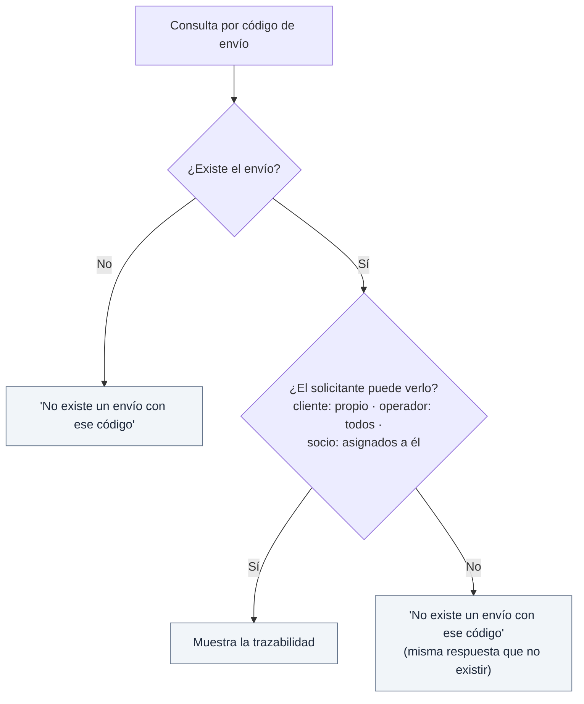

# 03 · Dominio y ledger encadenado

El estado canónico de cada envío es un **ledger de avances** encadenados por hash SHA-256 y firmados
por el responsable que los emite (principio I). Es inmutable: nada se actualiza ni se borra; las
correcciones serían avances nuevos. Todo acceso al ledger pasa por la interfaz `LedgerRepository`.

## Modelo de dominio

## Etapas del envío (máquina de estados)

Las etapas avanzan siempre en orden, sin retroceso ni repetición (regla transversal 2). "Asignado a
socio" solo se alcanza asignando un socio de tierra desde "En aeropuerto destino".

## Encadenamiento e integridad (HU-05)

Cada avance guarda la huella del anterior. Verificar recalcula las huellas y señala el primer avance
alterado.

## Privacidad en consultas (HU-04 / HU-05)

Quien no puede ver un envío recibe la misma respuesta que si no existiera, para no filtrar su
existencia.

