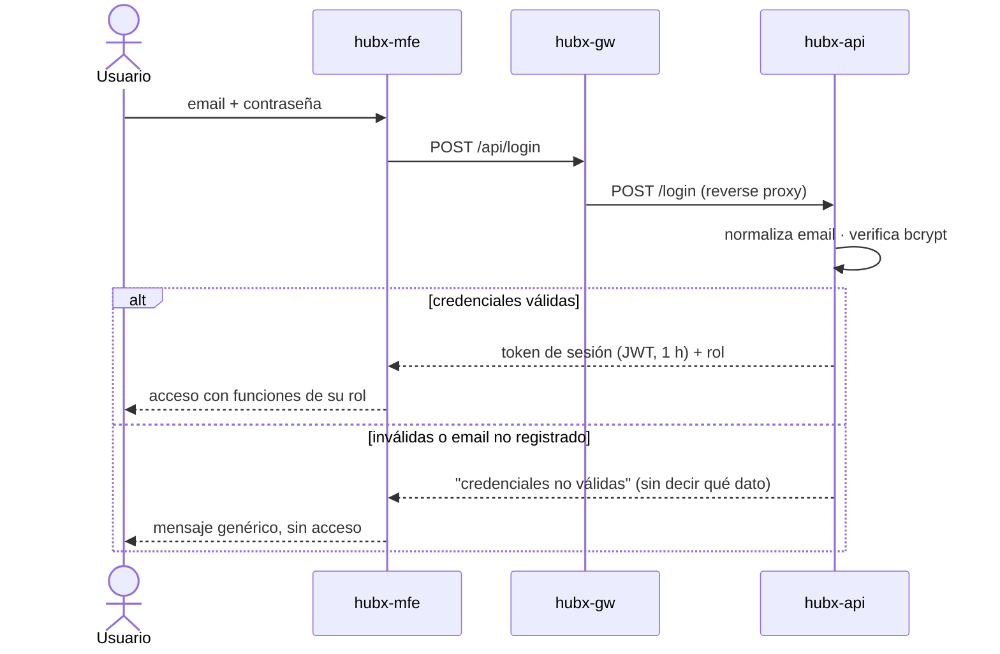
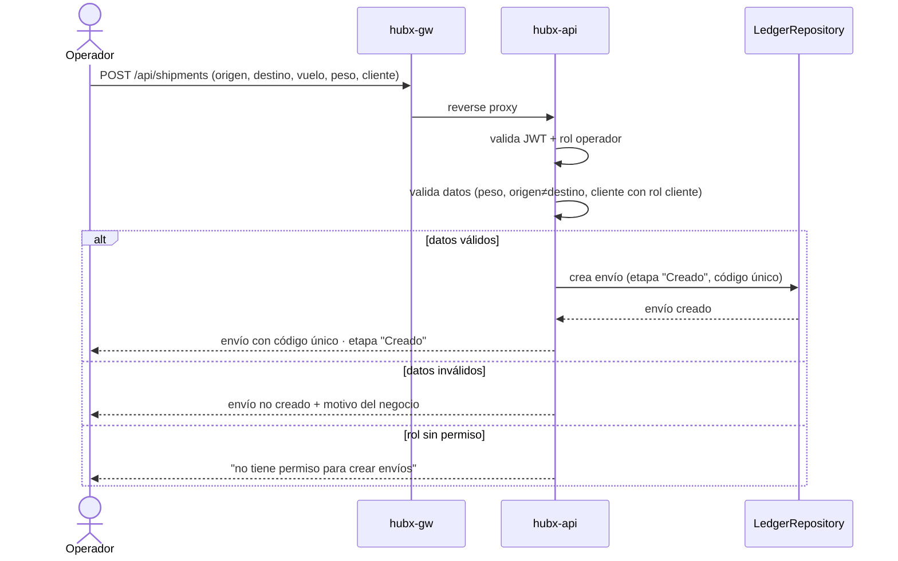
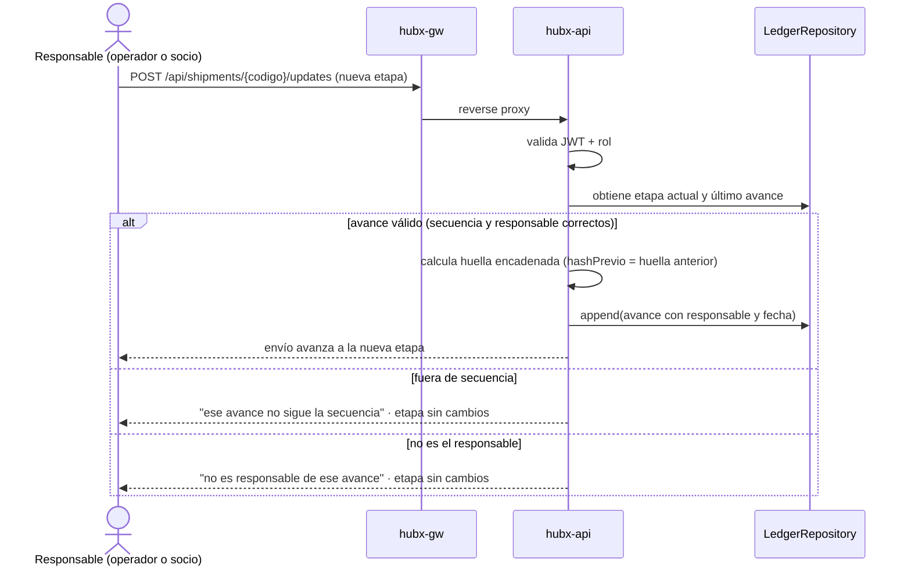
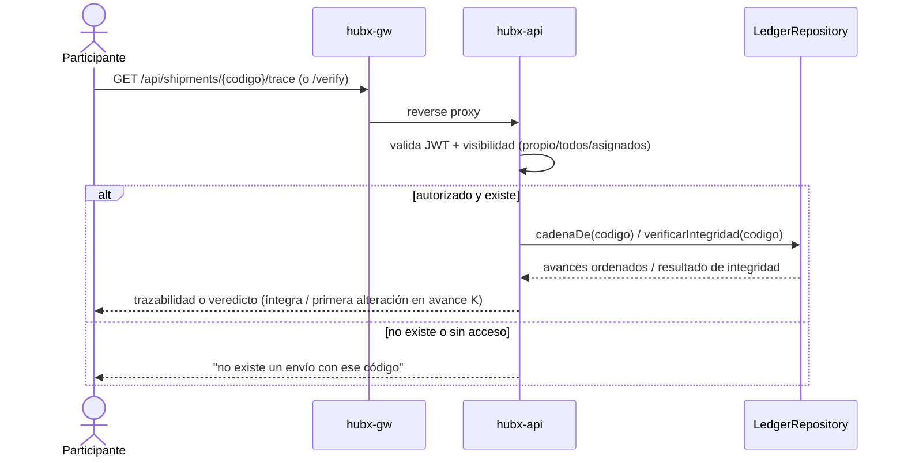
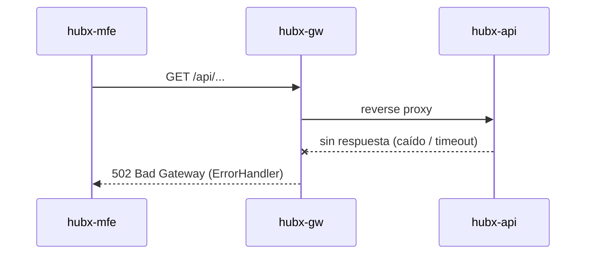

# 04 · Flujos de la aplicación

Secuencias de las historias del backlog. Todas pasan por el gateway (`/api`); la API valida el JWT
por su cuenta (principio II) y aplica las reglas de negocio.

## HU-01 · Iniciar sesión

El correo ignora mayúsculas y espacios. Si fallan las credenciales, el mensaje no revela qué dato
estuvo mal. La sesión dura una hora.

## HU-02 · Crear un envío

Solo operador. Peso entre 0.1 y 5000 kg, origen distinto de destino, cliente registrado con rol
cliente. Crear no registra avance todavía.

## HU-03 · Registrar un avance

El responsable de la etapa registra su avance; se encadena al anterior por su huella. La secuencia
es estricta y el responsable debe ser el correcto.

## HU-04 / HU-05 · Ver trazabilidad y verificar integridad

## Camino del error de upstream (gateway)

Si la API no responde, el gateway traduce el fallo de transporte en un `502` explícito en vez de
dejar la conexión colgando.

