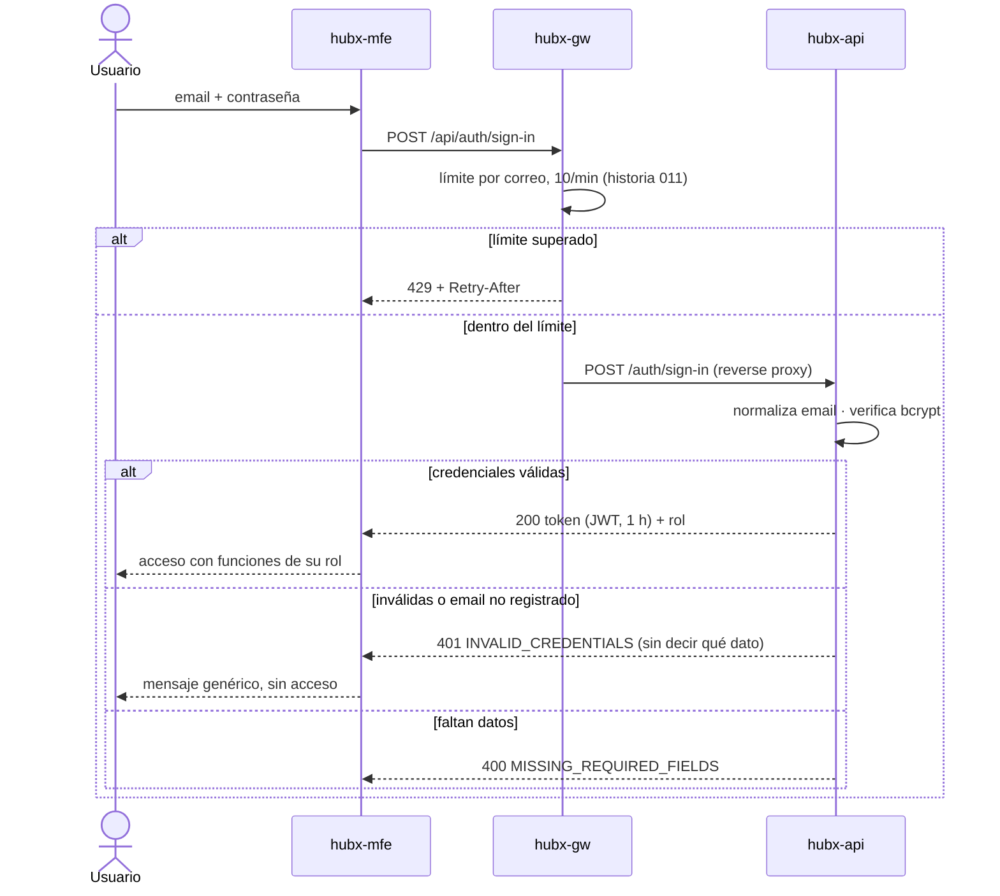
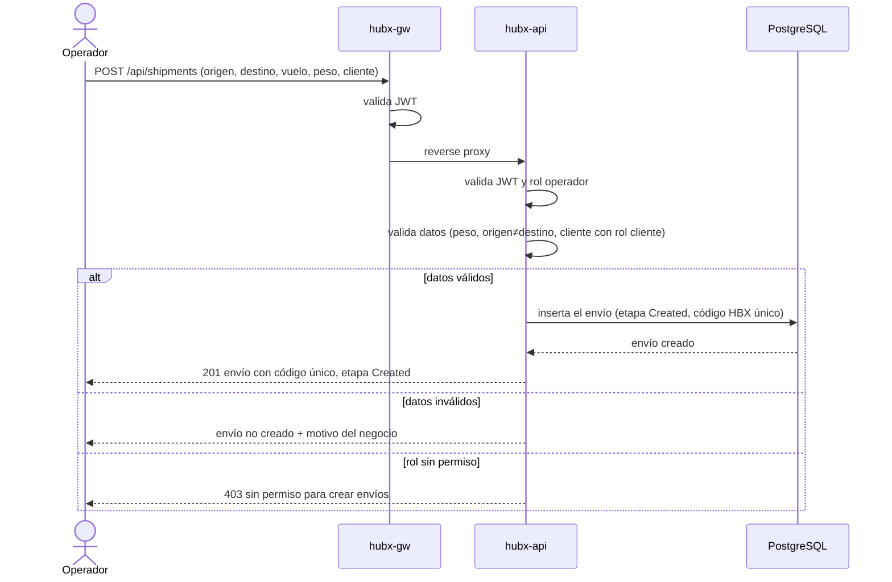
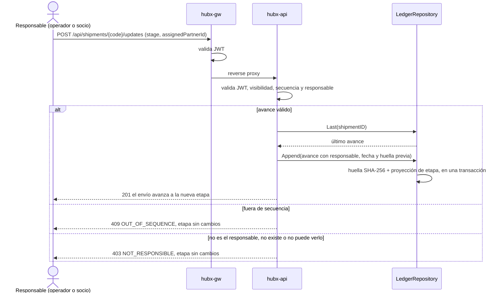
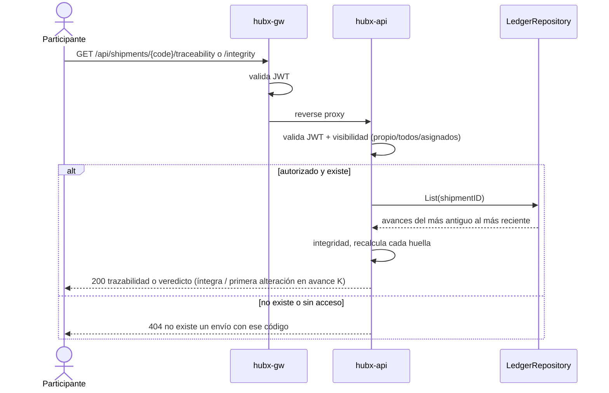
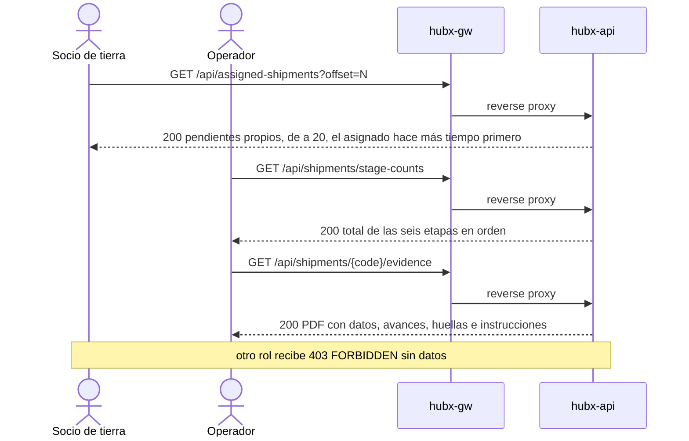
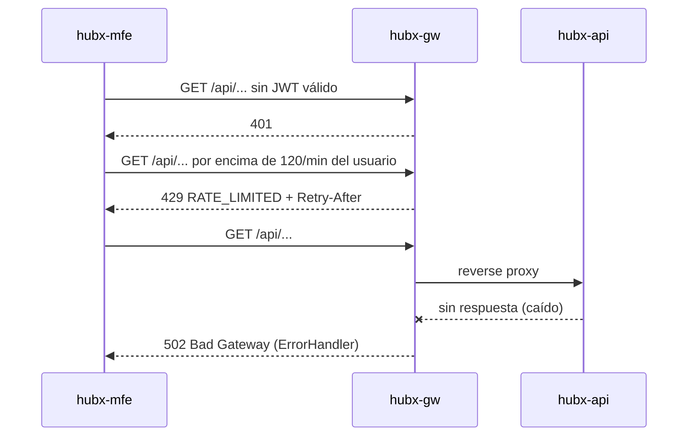

# 04 · Flujos de la aplicación

Secuencias de las historias implementadas. Todas pasan por el gateway (`/api`), que valida el JWT; la API
exige el secreto del gateway, valida el JWT otra vez (principio II) y aplica las reglas de negocio. HU-06 y
HU-08 no están implementadas.

## HU-01 · Iniciar sesión

El correo ignora mayúsculas y espacios. Si fallan las credenciales, el mensaje no revela qué dato
estuvo mal. La sesión dura una hora.

## HU-02 · Crear un envío

Solo operador. Peso entre 0.1 y 5000 kg, origen distinto de destino, cliente registrado con rol
cliente. Crear no registra avance todavía, así que no toca el ledger.

## HU-03 · Registrar un avance

El responsable de la etapa registra su avance; se encadena al anterior por su huella. La secuencia
es estricta y el responsable debe ser el correcto. Al asignar, el socio se elige con
`GET /api/ground-partners`.

## HU-04 / HU-05 · Ver trazabilidad y verificar integridad

## HU-07 / HU-09 / HU-10 · Asignados, conteos y evidencia

## Caminos de rechazo del gateway

Si la API no responde, el gateway traduce el fallo de transporte en un `502` explícito en vez de
dejar la conexión colgando. Sin sesión válida la petición no llega a la API. El `429` es de la
*(historia 011)*.

