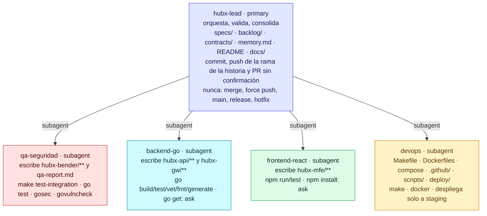
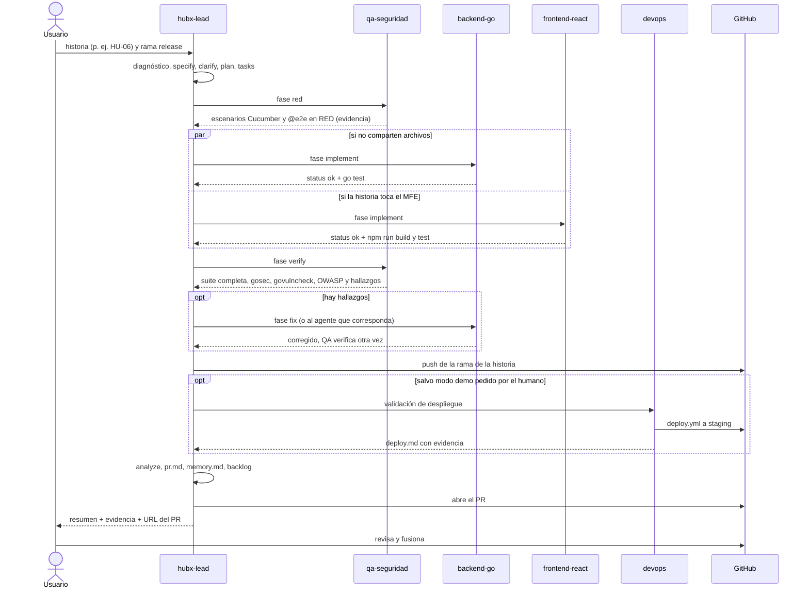
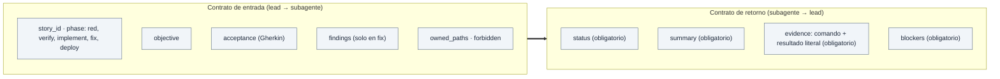
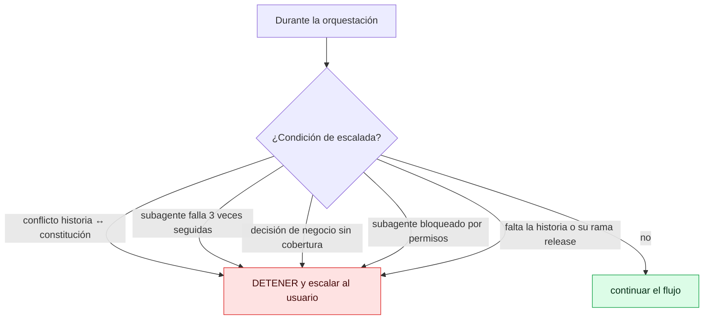

# 05 · Flujos agénticos

HUBX se construye con un equipo de cinco agentes sobre un ciclo Spec-Driven Development (`.specify/` +
Spec Kit). La fuente de sus instrucciones es `.opencode/agents/`; `make agents-sync` genera las versiones de
Kiro y Claude Code. El agente por defecto es `hubx-lead`, único punto de entrada y única voz que reporta al
usuario.

## Equipo y fronteras por permisos

El aislamiento entre agentes se refuerza por permisos (denegación por defecto + allow-list), no solo
por convención. Además `make agents-zones` (CI) rechaza un commit `[agent:rol]` que toque archivos fuera de
la zona de ese rol.

Crear una rama `release/*` nueva desde `main` pide confirmación humana. Ningún agente fusiona: es una decisión
humana siempre.

## Ciclo SDD por historia

El lead recibe la historia y su rama de integración (`release/vX.Y.Z[-nombre]`), ambas obligatorias, y conduce
las fases sin saltar ninguna y sin avanzar sin evidencia. El punto de revisión humana es el PR. (El
`workflow.yml` genérico de Spec Kit trae puertas de revisión entre fases; el flujo de `hubx-lead` no lo usa.)

```mermaid
flowchart LR
    IN["historia + rama de integración"] --> S["specify<br/>spec.md: QUÉ y POR QUÉ"]
    S --> C["clarify<br/>máx. 3 preguntas por ronda"]
    C --> P["plan<br/>plan.md y contrato: el CÓMO"]
    P --> T["tasks<br/>tasks.md: tareas por agente"]
    T --> I["implement<br/>delegación en subagentes"]
    I --> A["analyze<br/>contraste vs spec + constitución"]
    A --> PR["pr<br/>push de la rama y PR a la rama de integración"]
    PR --> H{{"revisión y merge humanos"}}

    classDef phase fill:#eef2ff,stroke:#6366f1,color:#312e81;
    classDef gate fill:#fef9c3,stroke:#ca8a04,color:#422006;
    class IN,S,C,P,T,I,A,PR phase;
    class H gate;
```

## Orquestación de la fase implement

QA escribe primero las pruebas que fallan (RED), backend y frontend implementan en paralelo contra el
contrato, QA verifica y devops despliega la rama a staging y lo registra en `deploy.md`. Cada subagente
devuelve un JSON con `status` y evidencia; el lead no avanza si `status` no es `ok` y hace un commit
`[agent:rol]` por entrega aceptada.

## Contrato de delegación

El lead envía a cada subagente un contrato explícito y exige un contrato de retorno. Así la
evidencia es verificable y las fronteras quedan declaradas en cada invocación.

## Reglas de escalada

