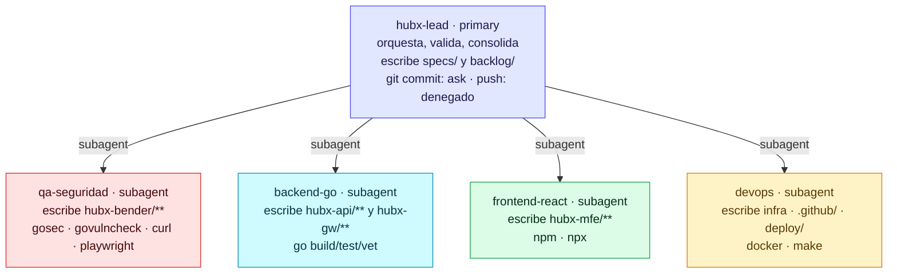
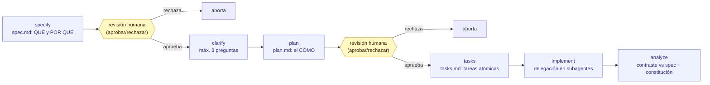
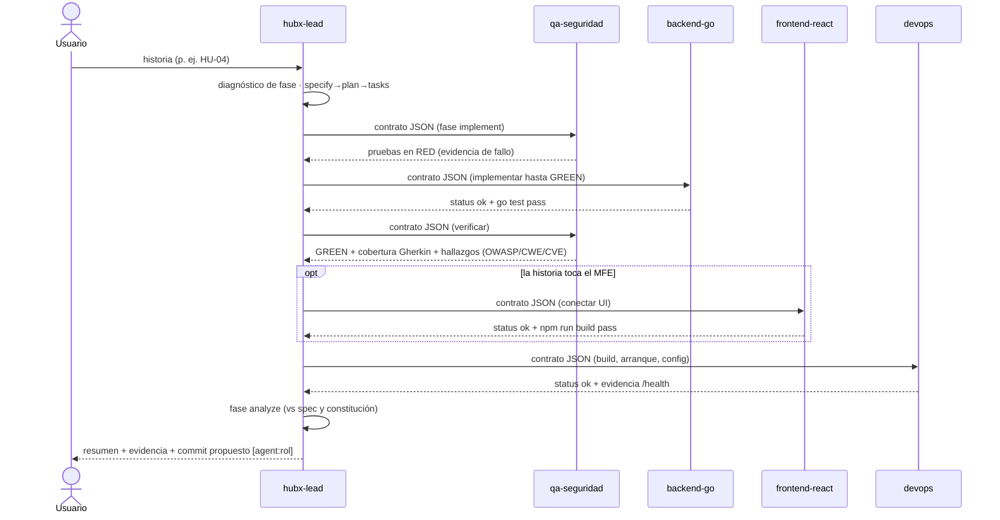
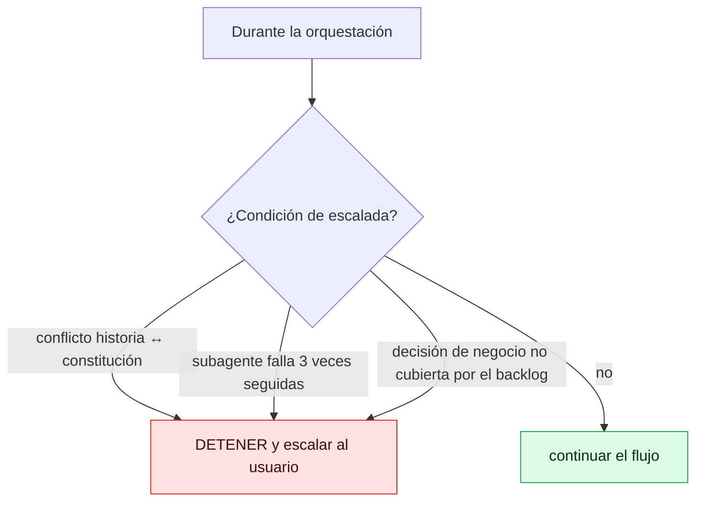

# 05 · Flujos agénticos

HUBX se construye con un equipo de cinco agentes (`.opencode/agents/`) sobre un ciclo
Spec-Driven Development (`.specify/` + Spec Kit). El agente por defecto es `hubx-lead`, único punto
de entrada y única voz que reporta al usuario.

## Equipo y fronteras por permisos

El aislamiento entre agentes se refuerza por permisos (denegación por defecto + allow-list), no solo
por convención. Cada frontera de la arquitectura tiene un guardrail agéntico que la hace cumplir.

## Ciclo SDD por historia

El lead conduce las fases sin saltar ninguna y sin avanzar sin evidencia (constitución, proceso de
desarrollo). El `workflow.yml` de Spec Kit añade puertas de revisión humana entre fases.

## Orquestación de la fase implement

Orden por defecto: QA escribe primero las pruebas que fallan (RED), backend implementa hasta GREEN,
QA verifica, luego frontend si aplica, y devops cierra con build y arranque. Cada subagente devuelve
un contrato JSON con `status` y evidencia; el lead no avanza si `status != ok`.

## Contrato de delegación

El lead envía a cada subagente un contrato explícito y exige un contrato de retorno. Así la
evidencia es verificable y las fronteras quedan declaradas en cada invocación.

```mermaid
flowchart LR
    subgraph IN["Contrato de entrada (lead → subagente)"]
        I1["story_id · phase · objective"]
        I2["acceptance (Gherkin)"]
        I3["constraints (principios)"]
        I4["owned_paths · forbidden"]
        I5["report_schema"]
    end
    subgraph OUT["Contrato de retorno (subagente → lead)"]
        O1["status: ok|blocked|failed"]
        O2["summary · artifacts"]
        O3["evidence (comando + resultado)"]
        O4["findings (severidad, OWASP, CWE, CVE)"]
        O5["decisions · blockers · next_agent"]
    end
    IN ==> OUT

    classDef io fill:#f1f5f9,stroke:#64748b,color:#1e293b;
    class I1,I2,I3,I4,I5,O1,O2,O3,O4,O5 io;
```

## Reglas de escalada

