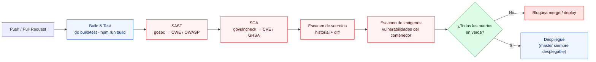
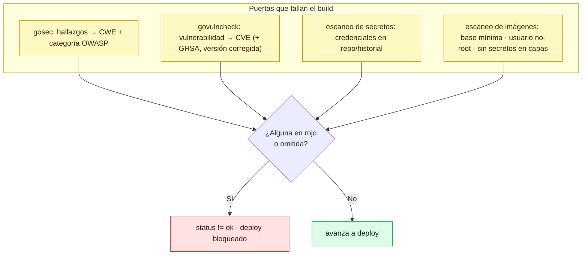
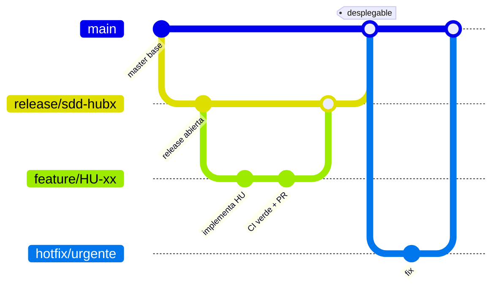
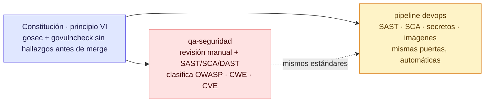

# 06 · DevSecOps y CI/CD

El agente `devops` define todo el pipeline como **pipeline as code** versionado en `.github/**`,
con seguridad integrada (shift-left) y puertas que bloquean el despliegue. La constitución exige que
`gosec` y `govulncheck` pasen sin hallazgos antes de merge, CI verde antes de cualquier merge, y
`master`/`main` siempre desplegable.

> *(Pendiente):* el pipeline aún no existe en `.github/`. Este documento describe el objetivo
> definido en `.opencode/agents/devops.md`.

## Pipeline as code (etapas y puertas)

## Puertas de calidad y seguridad

Cada etapa produce un artefacto o reporte. Los secretos del pipeline vienen del gestor de secretos
del CI (nunca en el YAML) y el workflow usa mínimo privilegio.

## Modelo de ramas (constitución · Integración y Despliegue)

`release` sale de `master`; las `feature` entran a `release`; `release` entra a `master`; los
hotfixes nacen de `master` y vuelven a `master`. Cada feature con PR obligatorio y CI verde.

## Relación con los agentes de seguridad

`qa-seguridad` y el pipeline de `devops` comparten las mismas herramientas y la misma clasificación
de hallazgos (OWASP Top 10, CWE, CVE), de modo que lo que QA revisa manualmente es lo que el pipeline
verifica de forma automática.

