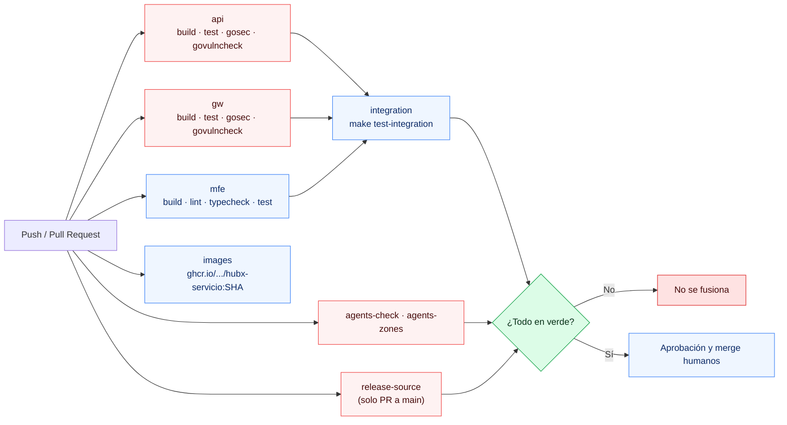
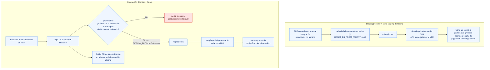
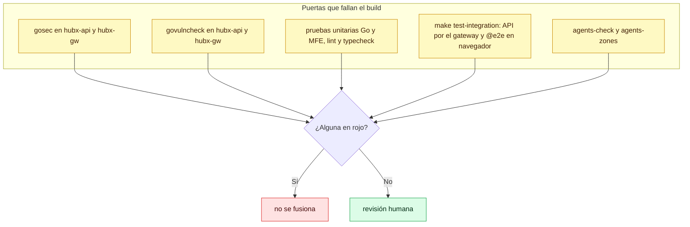
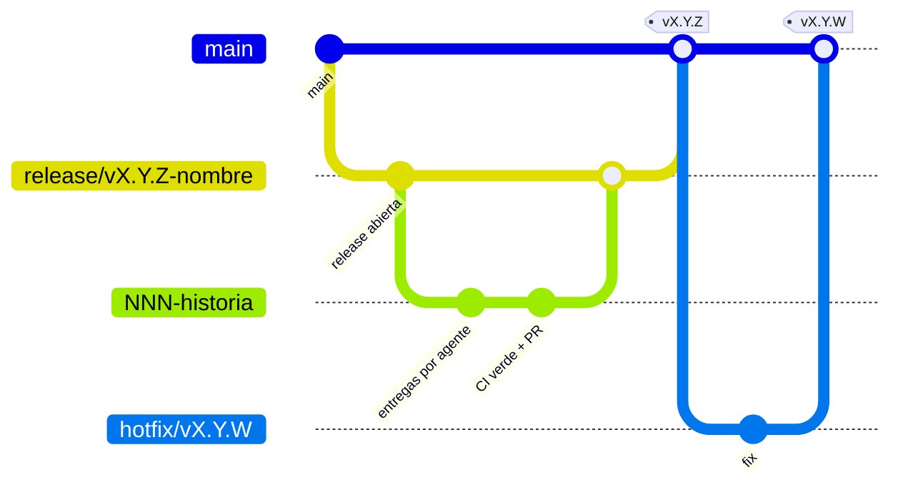
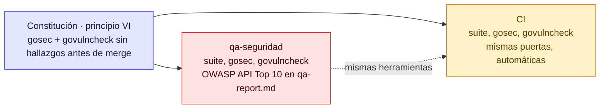

# 06 · DevSecOps y CI/CD

El agente `devops` mantiene el pipeline como código en `.github/workflows/`. La constitución exige que
`gosec` y `govulncheck` pasen sin hallazgos antes de merge, CI verde antes de cualquier merge, y
`main` siempre desplegable.

| Workflow | Cuándo | Qué hace |
|---|---|---|
| `ci.yml` | push y PR | build, pruebas, gosec, govulncheck e integración |
| `agents.yml` | push y PR | `agents-check`; `agents-zones` en PR que no van a `main` |
| `main-source.yml` | PR a `main` | solo `release/vX.Y.Z[-nombre]` o `hotfix/vX.Y.Z[-nombre]` |
| `images.yml` | push | imágenes en GHCR etiquetadas con el SHA |
| `deploy-staging.yml` | PR fusionado en una rama distinta de `main` | llama a `deploy.yml` (staging) |
| `deploy.yml` | manual o llamado | despliega las imágenes de un commit a un entorno |
| `release.yml` | release o hotfix fusionado en `main` | tag, GitHub Release, sincronización y producción |

## Pipeline as code (etapas y puertas)

Las imágenes se construyen solo en push. El escaneo de secretos y el de imágenes no existen en los workflows.

## Entornos y promoción

Se construye una vez: los entornos despliegan imágenes, nunca ramas. La imagen probada en staging es la que se
promueve.

Sin `DEPLOY_PRODUCTION=true`, los trabajos `promotable` y `deploy` no se ejecutan. Una release pasa por staging
antes; un hotfix solo si alguien lo despliega a mano. Los agentes no pueden desplegar a producción. La exclusión de
`@needs-limited-gateway` es de la *(historia 011)*.

## Puertas de calidad y seguridad

Los secretos del pipeline vienen de los entornos de GitHub (nunca en el YAML) y los workflows declaran
permisos mínimos.

## Modelo de ramas (constitución · Integración y Despliegue)

`main` es la única rama permanente. `release/vX.Y.Z[-nombre]` sale de `main`; las ramas de historia `NNN-nombre`
entran a la release por PR; la release entra a `main`; los hotfixes nacen de `main` y vuelven a `main`. Las ramas
se borran al fusionarse, y CI crea el tag (nunca a mano). No hay backports.

## Relación con los agentes de seguridad

`qa-seguridad` y el pipeline usan las mismas herramientas: lo que QA ejecuta antes del PR es lo que CI repite.
QA añade la revisión con el OWASP API Security Top 10 en `qa-report.md`.

